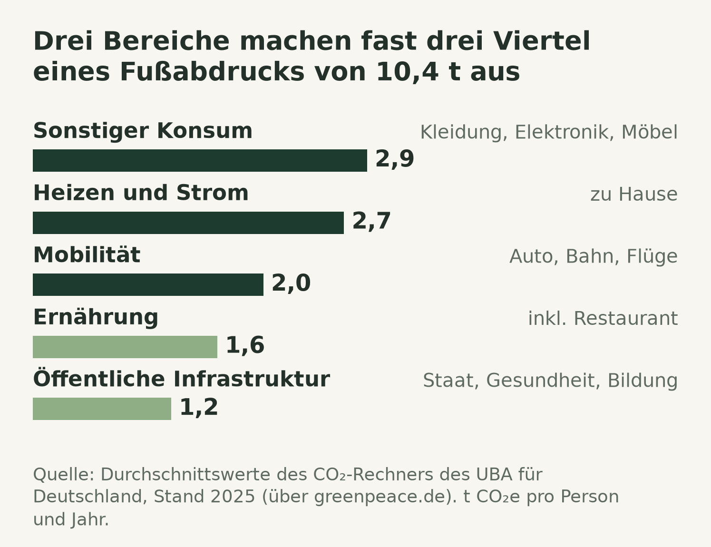

Kurz gesagt

- **Ein Land, vier korrekte Zahlen.** Der CO₂-Fußabdruck pro Kopf in Deutschland wird mit allem zwischen 6,8 und 10,4 Tonnen im Jahr angegeben. Die Werte unterscheiden sich darin, was sie mitzählen, nicht darin, wie gut sie messen.
- **Zwei verschiedene Messgrößen teilen sich ein Wort.** Der CO₂-Fußabdruck ist eine Masse an Treibhausgasen. Der ökologische Fußabdruck ist eine Fläche, und etwa 60 % davon sind CO₂, umgerechnet in einen Wald, den es nicht gibt.
- **Private Entscheidungen erreichen ungefähr die Hälfte.** Wer ohne Auto lebt, weniger fliegt, pflanzlich isst und Ökostrom bezieht, spart grob geschätzt fünf bis sieben der 10,4 Tonnen ein, die eine Person in Deutschland im Schnitt verursacht. Der Rest steckt in Stromnetz, Gebäuden, Bahn und Industrie.
- **Ein Handabdruck wird nie abgezogen.** Was jemand bei anderen verändert, zählt als Handabdruck. Mehrere Menschen können sich dieselbe vermiedene Tonne zu Recht zuschreiben, deshalb darf er neben dem Fußabdruck stehen, aber nie mit ihm verrechnet werden.

Fußabdruck-Zahlen werden ständig zitiert und fast nie zusammen mit der Bilanzierungsregel, die dahintersteht. Dieser Beitrag beantwortet vier Fragen:

- Warum weichen die veröffentlichten Fußabdrücke für dasselbe Land voneinander ab?
- Was steckt in einem persönlichen Fußabdruck, und was kann eine Person daran ändern?
- Was fügt der ökologische Fußabdruck hinzu?
- Was ist ein Handabdruck, und wie verhält er sich zum Fußabdruck?

## 1. Ein Land, vier korrekte Zahlen

Jeder veröffentlichte Pro-Kopf-Fußabdruck für Deutschland stimmt für die Frage, die er beantwortet. Die Werte unterscheiden sich in drei Entscheidungen:

- **Welche Gase.** Nur Kohlendioxid, oder auch Methan, Lachgas und Kältemittel.
- **Welche Grenze.** Nur was innerhalb Deutschlands ausgestoßen wird, oder alles, was der Konsum in Deutschland verursacht, auch im Ausland.
- **Ob der Staat aufgeteilt wird.** Der CO₂-Rechner für Privatpersonen gibt allen Einwohnern einen gleichen Anteil an Straßen, Krankenhäusern und Verwaltung.

Die engste Zahl, 6,77 Tonnen CO₂, die 2024 innerhalb der Grenze ausgestoßen wurden, ist die, die nationale Statistiken berichten [\[1\]](https://ourworldindata.org/grapher/co2-emissions-per-capita). Mit den übrigen Treibhausgasen ergeben sich 649 Millionen Tonnen für 2025 [\[2\]](https://www.umweltbundesamt.de/daten/klima/treibhausgas-emissionen-in-deutschland), also 7,8 Tonnen für jeden der etwa 83,5 Millionen Einwohner [\[3\]](https://www.destatis.de/DE/Presse/Pressemitteilungen/2026/01/PD26_032_124.html). Eine Bereinigung um den Handel zieht ab, was Deutschland für den Export produziert, und rechnet hinzu, was im Ausland für Deutschland produziert wird. Damit steigt der CO₂-Wert für 2023 von 7,02 auf 9,09 Tonnen [\[4\]](https://ourworldindata.org/grapher/consumption-co2-per-capita), unterm Strich wird also gut ein Fünftel des CO₂ hinter dem deutschen Konsum im Ausland ausgestoßen. Der CO₂-Rechner des Umweltbundesamts (UBA) kommt auf 10,4 Tonnen [\[5\]](https://www.greenpeace.de/klimaschutz/klimakrise/deutschland-co2-fussabdruck): handelsbereinigt, alle Gase, die zusätzliche Erwärmung durch Flugzeuge in großer Höhe und ein Anteil am öffentlichen Sektor [\[6\]](https://www.umweltbundesamt.de/system/files/medien/11850/publikationen/19_2025_texte.pdf).

Ein nationaler Wert geteilt durch die Bevölkerung ist außerdem ein Anteil und nicht der Fußabdruck eines bestimmten Menschen. Er gibt allen denselben Wert, während in einer deutschen Erhebung von 2016 das Zehntel der Bevölkerung mit den niedrigsten Emissionen bei etwa 7 Tonnen lag und das Zehntel mit den höchsten bei etwa 17,7 [\[7\]](https://www.umweltbundesamt.de/service/uba-fragen/wie-hoch-sind-die-treibhausgasemissionen-pro-person). Bevor zwei Fußabdruck-Zahlen verglichen werden, müssen die drei Entscheidungen oben übereinstimmen.

## 2. Was in einem persönlichen Fußabdruck steckt

Die 10,4 Tonnen des CO₂-Rechners sind der Ausgangspunkt für alle, die ihre eigene Zahl wissen wollen. Der Rechner arbeitet auf zwei Arten gleichzeitig:

- **Von unten nach oben** für das, was eine Person selbst angeben kann: gefahrene Kilometer, Heizöl, Strom, Flüge, jeweils multipliziert mit einem Emissionsfaktor.
- **Von oben nach unten** für das, was niemand angeben kann: Die Emissionen hinter einem Hemd, einem Restaurantbesuch oder einem Krankenhaus stammen aus nationalen Sektorsummen, geteilt durch die Bevölkerung und skaliert mit den Antworten der Person. Niemand addiert die Produkte, die er gekauft hat [\[6\]](https://www.umweltbundesamt.de/system/files/medien/11850/publikationen/19_2025_texte.pdf).

Die Bereiche liegen nicht dort, wo man sie intuitiv vermuten würde. Der größte ist der allgemeine Konsum: Kleidung, Elektronik, Möbel und Dienstleistungen, zusammen mit den Maschinen und Fabrikgebäuden, mit denen sie hergestellt wurden. Heizen und Strom zu Hause folgen an zweiter Stelle, mit zusammen 2,7 Tonnen [\[5\]](https://www.greenpeace.de/klimaschutz/klimakrise/deutschland-co2-fussabdruck). Und 1,2 Tonnen sind ein gleicher Anteil am Staat, von der Verwaltung bis zu Krankenhäusern und Straßen, den keine persönliche Entscheidung ändern kann [\[6\]](https://www.umweltbundesamt.de/system/files/medien/11850/publikationen/19_2025_texte.pdf).

Ob "die Fabrik" in einem Fußabdruck enthalten ist, hängt von der Methode ab. In der gesamtwirtschaftlichen Methode hinter dem Rechner wird sie mitgezählt, etwa 153 Millionen Tonnen Emissionen aus Investitionen im Jahr 2021, allerdings größtenteils unter dem allgemeinen Konsum verbucht und nicht dem gekauften Produkt zugeordnet [\[6\]](https://www.umweltbundesamt.de/system/files/medien/11850/publikationen/19_2025_texte.pdf). Produkt-Fußabdrücke, die eine Lieferkette Schritt für Schritt nachverfolgen, hören meist vor dem Fabrikgebäude und den Maschinen auf. Dieser Schnitt unterschätzt die Summe, bei manchen Produktsystemen um bis zu etwa die Hälfte, und zwar immer in dieselbe Richtung [\[8\]](https://doi.org/10.1162/10881980052541981).

## 3. Der ökologische Fußabdruck besteht größtenteils aus CO₂

Der ökologische Fußabdruck beantwortet eine andere Frage als der CO₂-Fußabdruck und wiederholt ihn in der Praxis doch nur in einer anderen Einheit:

- **Er misst eine Fläche.** Wie viel biologisch produktive Land- und Meeresfläche eine Bevölkerung braucht, in globalen Hektar, verglichen mit der tatsächlich verfügbaren Fläche, der Biokapazität.
- **Sein CO₂-Anteil ist ein Wald, den es nicht gibt.** Emissionen werden in die Waldfläche umgerechnet, die nötig wäre, um sie aufzunehmen.
- **Dieser Anteil dominiert.** Für Deutschland waren es 2023 2,43 von 4,03 globalen Hektar pro Person, etwa 60 % [\[9\]](https://data.footprintnetwork.org/).

Ohne die CO₂-Schicht bleibt etwa das übrig, was Deutschlands eigenes Land und Meer nachwachsen lassen, und das hat sich seit 1961 kaum verändert [\[9\]](https://data.footprintnetwork.org/). Die bekannte Aussage, die Menschheit verbrauche etwa 1,7 Erden, vergleicht in denselben Konten den weltweiten Bedarf mit der weltweiten Biokapazität. Sie sagt daher vor allem, dass mehr CO₂ ausgestoßen wird, als Wälder aufnehmen. Das stimmt, und es lässt sich bereits in Tonnen messen. Kritiker folgern daraus, dass die Kennzahl für Wissenschaft und politische Entscheidungen ungeeignet ist [\[10\]](https://journals.plos.org/plosbiology/article?id=10.1371/journal.pbio.1001700). Ihre Urheber halten dagegen, dass sie eine bestimmte Frage beantwortet, nämlich wie viel Biokapazität eine Bevölkerung nutzt im Verhältnis zu dem, was vorhanden ist, und dass der große CO₂-Anteil das tatsächliche Gewicht der fossilen Brennstoffe widerspiegelt [\[11\]](https://journals.plos.org/plosbiology/article?id=10.1371/journal.pbio.1001701).

Beide Seiten haben recht, nur in unterschiedlichen Punkten. Die Flächenzahl und der Erdüberlastungstag zeigen einem breiten Publikum in einer einzigen Zahl, dass der Konsum über dem liegt, was der Planet nachwachsen lässt. Für die Wahl zwischen zwei Optionen fügt die Umrechnung in Fläche eine Annahme hinzu und keine Information. Das Datum verschiebt sich außerdem mit dem Modell: Die ganze Zeitreihe wird jedes Jahr neu berechnet, und 2026 hat ein überarbeiteter Wert dafür, wie viel CO₂ die Ozeane aufnehmen, den Erdüberlastungstag um acht Tage nach hinten verschoben, obwohl sich die tatsächliche Lage verschlechtert hat [\[12\]](https://www.overshootday.org/newsroom/past-earth-overshoot-days/).

## 4. Was eine Person ändern kann

Übersichtsarbeiten zu individuellen Klimamaßnahmen sind sich einig, welche privaten Hebel groß sind. Was sie für eine bestimmte Person wert sind, ist eine andere Frage:

- **Die größten Hebel** sind ein Leben ohne Auto, der Verzicht auf Langstreckenflüge, Ökostrom und eine pflanzliche Ernährung [\[13\]](https://doi.org/10.1088/1748-9326/ab8589) [\[14\]](https://doi.org/10.1088/1748-9326/aa7541).
- **Eine Einsparung ist durch das begrenzt, was jemand in diesem Bereich schon ausstößt.** Ohne Auto zu leben bringt nichts, wenn man ohnehin keins hat, und ein Ökostromtarif kann höchstens den Stromanteil der 2,7 Tonnen für Heizen und Strom einsparen.
- **Zusammen sparen die realistischen Hebel ungefähr fünf bis sieben der 10,4 Tonnen ein**, eine grobe Summe der veröffentlichten Mediane nach Abzug ihrer Überschneidungen und dieser Obergrenzen. Klimaverträglich wäre ein Wert deutlich unter einer Tonne pro Person und Jahr [\[7\]](https://www.umweltbundesamt.de/service/uba-fragen/wie-hoch-sind-die-treibhausgasemissionen-pro-person).

Die veröffentlichten Rangfolgen sind Mediane über viele Studien, gemessen an einer Person mit durchschnittlichen Emissionen. Die Reihenfolge stimmt für eine Bevölkerung und kann für den Einzelnen falsch sein. Die Ernährung zeigt das in abgeschwächter Form. In einem einheitlichen Datensatz ist der Schritt von mittlerem Fleischkonsum zu veganer Ernährung etwa 1,7 Tonnen im Jahr wert, der Schritt von vegetarisch zu vegan etwa 0,6 [\[15\]](https://www.nature.com/articles/s43016-023-00795-w). Für eine durchschnittliche deutsche Ernährung schätzt das Umweltbundesamt, dass eine vegane Ernährung die Emissionen aus der Ernährung um 38 bis 52 % senkt [\[16\]](https://www.umweltbundesamt.de/themen/landwirtschaft/landwirtschaft-umweltfreundlich-gestalten/fragen-antworten-zu-tierhaltung-ernaehrung). Auf die 1,6 Tonnen für Ernährung im Rechner angewendet [\[5\]](https://www.greenpeace.de/klimaschutz/klimakrise/deutschland-co2-fussabdruck), sind das ungefähr 0,6 bis 0,8 Tonnen im Jahr. Ein Hin- und Rückflug über jeweils etwa 1000 km, zum Beispiel Frankfurt–Barcelona, kommt bei 195 g CO₂e pro Personenkilometer auf etwa 0,4 Tonnen [\[17\]](https://doi.org/10.5281/zenodo.19208116). Ein Jahr ohne tierische Produkte entspricht also anderthalb bis zwei solcher Flüge.

Was nach den privaten Hebeln bleibt, sind Stromnetz, Gebäudebestand, Bahn, Güterverkehr und industrielle Prozesswärme sowie die 1,2 Tonnen öffentliche Infrastruktur. Nichts davon ist eine Konsumentscheidung.

## 5. Der Handabdruck

Der Handabdruck setzt dort an, wo die privaten Hebel aufhören. Er zählt, was jemand bei anderen verändert:

- **Was er umfasst:** ein Vermieter, der überzeugt wird, das Haus zu dämmen, ein Arbeitgeber, der Solarmodule aufs Dach setzt, eine Stadt, die eine Buslinie ändert. Ein persönlicher Fußabdruck kann nichts davon abbilden.
- **Woher er kommt:** Das Konzept stammt vom Centre for Environment Education in Indien und wurde in Deutschland von Germanwatch weiterentwickelt [\[18\]](https://www.germanwatch.org/en/90288).
- **Die Regel:** Ein Handabdruck wird neben dem Fußabdruck angegeben und nie von ihm abgezogen.

Die Regel folgt aus einer Eigenschaft. Ein Fußabdruck ordnet jede reale Tonne genau einer Person zu, ein Handabdruck kann das nicht. Ein Beispiel: In einem Haus mit zehn Wohnungen drängt eine Mieterin ein Jahr lang den Vermieter, das Gebäude zu dämmen, und danach stößt jede Wohnung eine halbe Tonne im Jahr weniger aus. Die zehn Fußabdrücke sinken zusammen um fünf Tonnen, genau das, was vermieden wurde. Die Mieterin, die das angestoßen hat, kann sich die fünf Tonnen außerdem zu Recht als Handabdruck zuschreiben, denn ohne sie wäre nichts passiert. Zusammengezählt ergibt das zehn Tonnen aus einem Ereignis, das fünf eingespart hat. Das ist kein Fehler. Die beiden Zahlen beantworten unterschiedliche Fragen, nämlich wie viel jemand verursacht und wie viel jemand verändert hat. Der CO₂-Rechner des UBA folgt derselben Regel: Ein kompensierter Flug zählt unter Mobilität weiter mit vollem Gewicht, und die Kompensation steht in einer eigenen Zeile [\[6\]](https://www.umweltbundesamt.de/system/files/medien/11850/publikationen/19_2025_texte.pdf).

Viele öffentliche Aussagen klären sich, sobald man die beiden auseinanderhält. "Unser Produkt hat vier Millionen Tonnen eingespart" ist eine Handabdruck-Aussage und sagt nichts darüber, wie viel ein Unternehmen ausstößt. "Wir haben unsere Emissionen um vier Millionen Tonnen gesenkt" ist eine Fußabdruck-Aussage und lässt sich an einer Bilanz prüfen. Eine Aussage, die vom einen ins andere rutscht, ist die übliche Form von Greenwashing, und deshalb schließen Leitfäden für Unternehmen aus, vermiedene Emissionen mit den eigenen Emissionen zu verrechnen [\[19\]](https://www.wbcsd.org/resources/guidance-on-avoided-emissions/).

## 6. Einschätzung

Jede Kennzahl beantwortet ihre eigene Frage, und die meiste Verwirrung entsteht, wenn eine Kennzahl die Frage einer anderen beantworten soll:

| Frage | Kennzahl |
|---|---|
| Erreicht ein Land sein gesetzliches Ziel? | Territoriale Emissionen in t CO₂e |
| Wie viel Erwärmung verursacht der Konsum einer Bevölkerung? | Konsumbasierte Emissionen in t CO₂e |
| Wo sollte ein Haushalt zuerst ansetzen? | CO₂-Rechner in t CO₂e |
| Verbraucht die Menschheit mehr, als der Planet nachwachsen lässt? | Ökologischer Fußabdruck in globalen Hektar |
| Was hat jemand über das eigene Leben hinaus verändert? | Handabdruck, getrennt angegeben |

Wo eine Entscheidung von der Antwort abhängt, sind Tonnen CO₂e mit genannter Systemgrenze die belastbare Einheit. Einen persönlichen Fußabdruck einmal zu berechnen lohnt sich, um die zwei oder drei Hebel zu finden, die für die eigene Situation groß sind, und um den Sockel darunter zu sehen. In diesem Sockel steckt der Großteil der verbleibenden Emissionen, und er sinkt durch strukturellen Wandel und nicht durch Einkaufsentscheidungen. Genau diese Arbeit macht der Handabdruck sichtbar.

## Quellen

1. Our World in Data, nach dem Global Carbon Project. *CO₂ emissions per capita*, Datenstand Juli 2026. https://ourworldindata.org/grapher/co2-emissions-per-capita
2. Umweltbundesamt. *Treibhausgas-Emissionen in Deutschland*, 2. Juli 2026. https://www.umweltbundesamt.de/daten/klima/treibhausgas-emissionen-in-deutschland
3. Statistisches Bundesamt. *Bevölkerung Deutschlands sinkt im Jahr 2025 um 0,1 %.* https://www.destatis.de/DE/Presse/Pressemitteilungen/2026/01/PD26_032_124.html
4. Our World in Data, nach dem Global Carbon Project. *Per capita consumption-based CO₂ emissions*, Datenstand Juli 2026. https://ourworldindata.org/grapher/consumption-co2-per-capita
5. Greenpeace Deutschland. *Ökologischer Fußabdruck und CO₂-Fußabdruck – was uns die Berechnung bringt*, mit Durchschnittswerten des CO₂-Rechners des UBA, 2025. https://www.greenpeace.de/klimaschutz/klimakrise/deutschland-co2-fussabdruck
6. Paar, A. et al. *Der UBA-CO₂-Rechner für Privatpersonen – Hintergrundinformationen zur Version 5.0.* Umweltbundesamt, TEXTE 19/2025. https://www.umweltbundesamt.de/system/files/medien/11850/publikationen/19_2025_texte.pdf
7. Umweltbundesamt. *Wie hoch sind die Treibhausgasemissionen pro Person in Deutschland und wie viel wäre klimaverträglich?* https://www.umweltbundesamt.de/service/uba-fragen/wie-hoch-sind-die-treibhausgasemissionen-pro-person
8. Lenzen, M. *Errors in Conventional and Input-Output-based Life-Cycle Inventories.* Journal of Industrial Ecology 4(4), 127–148, 2000. https://doi.org/10.1162/10881980052541981
9. Global Footprint Network und York University. *Open Data Platform*, National Footprint and Biocapacity Accounts. https://data.footprintnetwork.org/
10. Blomqvist, L. et al. *Does the Shoe Fit? Real versus Imagined Ecological Footprints.* PLOS Biology 11(11): e1001700, 2013. https://journals.plos.org/plosbiology/article?id=10.1371/journal.pbio.1001700
11. Rees, W.E., Wackernagel, M. *The Shoe Fits, but the Footprint is Larger than Earth.* PLOS Biology 11(11): e1001701, 2013. https://journals.plos.org/plosbiology/article?id=10.1371/journal.pbio.1001701
12. Global Footprint Network. *Past Earth Overshoot Days.* https://www.overshootday.org/newsroom/past-earth-overshoot-days/
13. Ivanova, D. et al. *Quantifying the potential for climate change mitigation of consumption options.* Environmental Research Letters 15(9), 093001, 2020. https://doi.org/10.1088/1748-9326/ab8589
14. Wynes, S., Nicholas, K.A. *The climate mitigation gap: education and government recommendations miss the most effective individual actions.* Environmental Research Letters 12(7), 074024, 2017. https://doi.org/10.1088/1748-9326/aa7541
15. Scarborough, P. et al. *Vegans, vegetarians, fish-eaters and meat-eaters in the UK show discrepant environmental impacts.* Nature Food 4, 565–574, 2023. https://www.nature.com/articles/s43016-023-00795-w
16. Umweltbundesamt. *Fragen und Antworten zu Tierhaltung und Ernährung.* https://www.umweltbundesamt.de/themen/landwirtschaft/landwirtschaft-umweltfreundlich-gestalten/fragen-antworten-zu-tierhaltung-ernaehrung
17. Allekotte, M., Kräck, J., Kämper, C. *Harmonized GHG Emission Factors for Air Travel in Germany.* ifeu paper 01/2026. https://doi.org/10.5281/zenodo.19208116
18. Germanwatch. *The Handprint Concept. Changing Structures towards Sustainability*, 2024. https://www.germanwatch.org/en/90288
19. World Business Council for Sustainable Development. *Guidance on Avoided Emissions v2.0*, 2025. https://www.wbcsd.org/resources/guidance-on-avoided-emissions/
