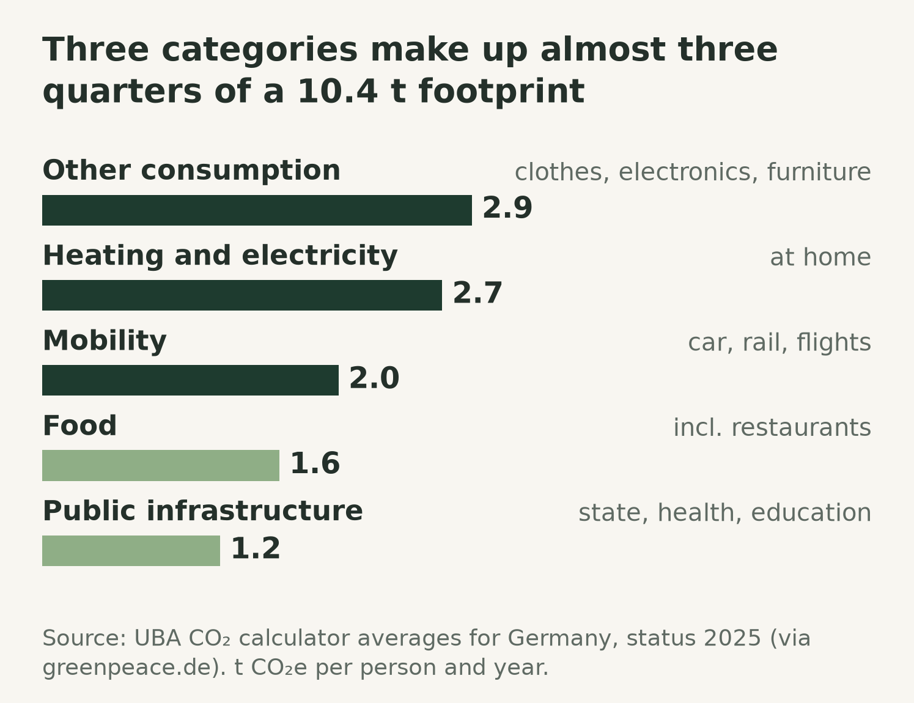
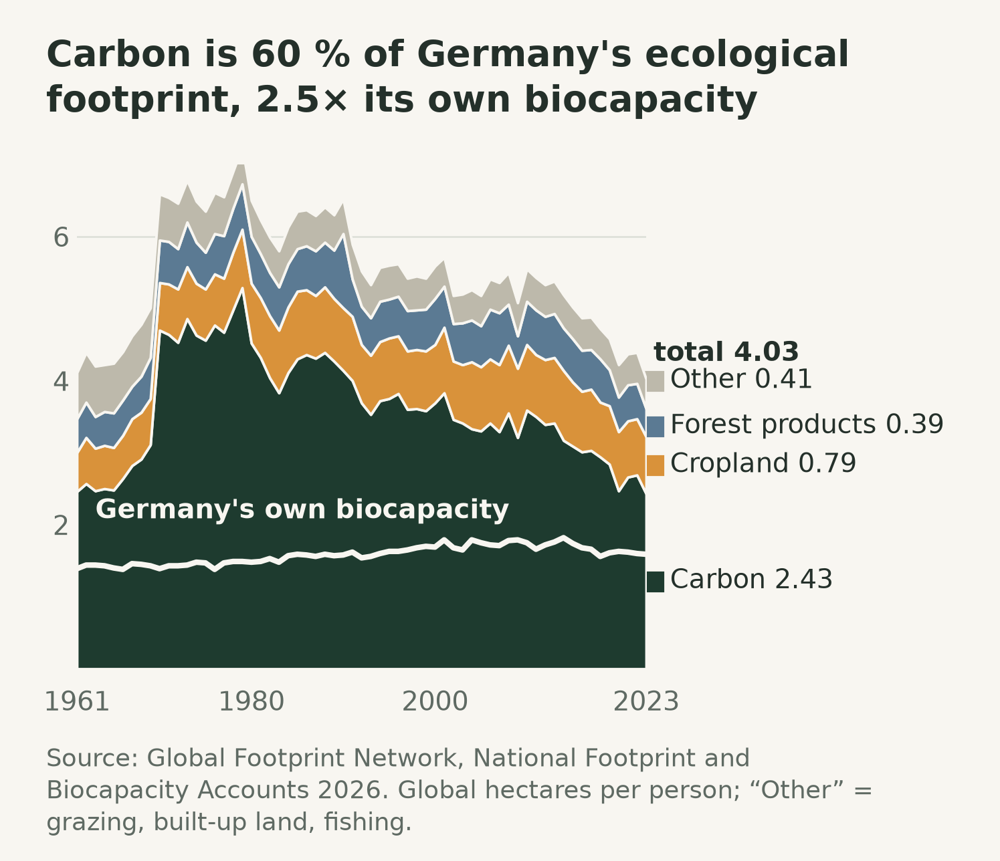

In short

- **One country, four correct numbers.** Germany's carbon footprint per person is published as anything from 6.8 to 10.4 tonnes a year. The figures differ in what they count, not in how well they measure.
- **Two different measurements share the word.** The carbon footprint is a weight of greenhouse gases. The ecological footprint is an area, and about 60 % of it is carbon converted into a forest that does not exist.
- **Private choices reach roughly half.** Living without a car, flying less, a plant-based diet and green electricity can remove, by a rough estimate, five to seven of a German resident's 10.4 tonnes. The rest is grid, buildings, rail and industry.
- **A handprint is never subtracted.** What someone changes at other people counts as a handprint. Several people can honestly claim the same avoided tonne, so it may stand beside a footprint but never be netted against it.

Footprint figures are quoted all the time, and almost never together with the accounting choice behind them. This article answers four questions:

- Why do published footprints for the same country disagree?
- What is inside a personal footprint, and what can one person change in it?
- What does the ecological footprint add?
- What is a handprint, and how does it relate to the footprint?

## 1. One country, four correct numbers

Every published per-person footprint for Germany is correct for the question it answers. They differ in three choices:

- **Which gases.** Carbon dioxide only, or also methane, nitrous oxide and refrigerants.
- **Which border.** Only what is emitted inside Germany, or everything German consumption causes, including abroad.
- **Whether the state is shared out.** The consumer calculator gives each resident an equal share of roads, hospitals and administration.

The narrowest number, 6.77 tonnes of CO₂ emitted inside the border in 2024, is the one national statistics report [\[1\]](https://ourworldindata.org/grapher/co2-emissions-per-capita). Adding the other greenhouse gases gives 649 million tonnes for 2025 [\[2\]](https://www.umweltbundesamt.de/daten/klima/treibhausgas-emissionen-in-deutschland), or 7.8 tonnes for each of about 83.5 million residents [\[3\]](https://www.destatis.de/DE/Presse/Pressemitteilungen/2026/01/PD26_032_124.html). Correcting for trade means subtracting what Germany produces for export and adding what is produced abroad for Germany. That raises the CO₂ figure for 2023 from 7.02 to 9.09 tonnes [\[4\]](https://ourworldindata.org/grapher/consumption-co2-per-capita), so on balance a little over a fifth of the CO₂ behind German consumption is emitted abroad. The consumer calculator of the German environment agency (UBA) arrives at 10.4 tonnes [\[5\]](https://www.greenpeace.de/klimaschutz/klimakrise/deutschland-co2-fussabdruck): trade-corrected, all gases, the extra warming of aircraft at altitude, and a share of the public sector [\[6\]](https://www.umweltbundesamt.de/system/files/medien/11850/publikationen/19_2025_texte.pdf).

A national figure divided by the population is also a share rather than anyone's footprint. It gives everyone the same value, while in a German survey from 2016 the lowest-emitting tenth of the population sat near 7 tonnes and the highest-emitting tenth near 17.7 [\[7\]](https://www.umweltbundesamt.de/service/uba-fragen/wie-hoch-sind-die-treibhausgasemissionen-pro-person). Before two footprint figures are compared, the three choices above have to match.

## 2. What sits inside a personal footprint

The 10.4 tonnes of the consumer calculator are the starting point for anyone who wants to know their own number. It is built in two ways at once:

- **Bottom-up** for what a person can report: kilometres driven, heating oil, electricity, flights, each multiplied by an emission factor.
- **Top-down** for what nobody can report: the emissions behind a shirt, a restaurant meal or a hospital come from national sector totals divided by the population, scaled by the person's answers. Nobody adds up the products they bought [\[6\]](https://www.umweltbundesamt.de/system/files/medien/11850/publikationen/19_2025_texte.pdf).

The categories are not where intuition puts them. The largest is general consumption: clothes, electronics, furniture and services, together with the machines and factory buildings that made them. Heating and electricity at home come second, at 2.7 tonnes together [\[5\]](https://www.greenpeace.de/klimaschutz/klimakrise/deutschland-co2-fussabdruck). And 1.2 tonnes are an equal share of the state, from administration to hospitals and roads, that no personal decision can change [\[6\]](https://www.umweltbundesamt.de/system/files/medien/11850/publikationen/19_2025_texte.pdf).

Whether "the factory" is in a footprint depends on the method. In the whole-economy method behind the calculator it is counted, about 153 million tonnes of investment emissions in 2021, but mostly booked under general consumption rather than attached to the product bought [\[6\]](https://www.umweltbundesamt.de/system/files/medien/11850/publikationen/19_2025_texte.pdf). Product footprints that trace a supply chain step by step usually stop before the factory building and the machines. That cut-off understates the total, in some product systems by up to about half, and always in the same direction [\[8\]](https://doi.org/10.1162/10881980052541981).

## 3. The ecological footprint is mostly carbon

The ecological footprint answers a different question from the carbon footprint, and in practice it repeats the carbon footprint in another unit:

- **It measures an area.** How much biologically productive land and sea a population needs, in global hectares, compared with the area actually available, the biocapacity.
- **Its carbon part is a forest that does not exist.** Emissions are converted into the forest area that would be needed to absorb them.
- **That part dominates.** For Germany in 2023 it was 2.43 of 4.03 global hectares per person, about 60 % [\[9\]](https://data.footprintnetwork.org/).

Without the carbon layer, what remains is close to what Germany's own land and sea regenerate, and it has barely moved since 1961 [\[9\]](https://data.footprintnetwork.org/). The well-known statement that humanity uses about 1.7 Earths, world demand against world biocapacity in the same accounts, therefore mostly says that more CO₂ is emitted than forests absorb. That is true, and it is already measurable in tonnes. Critics conclude that the metric is unsuitable for science and policy decisions [\[10\]](https://journals.plos.org/plosbiology/article?id=10.1371/journal.pbio.1001700). Its authors reply that it answers one specific question, how much biocapacity a population uses against how much exists, and that the large carbon share reflects the real weight of fossil fuels [\[11\]](https://journals.plos.org/plosbiology/article?id=10.1371/journal.pbio.1001701).

Both sides are right about different things. The area figure and Earth Overshoot Day show a general audience in one number that consumption exceeds what the planet regenerates. For choosing between two options the conversion into area adds an assumption and no information. The dates also move with the model: the whole series is recalculated every year, and in 2026 a revised figure for how much carbon the oceans absorb moved Earth Overshoot Day eight days later, while the actual situation got worse [\[12\]](https://www.overshootday.org/newsroom/past-earth-overshoot-days/).

## 4. What one person can change

Reviews of individual climate actions agree on which private levers are large. What they are worth for a particular person is a different matter:

- **The largest levers** are living without a car, avoiding long flights, renewable electricity and a plant-based diet [\[13\]](https://doi.org/10.1088/1748-9326/ab8589) [\[14\]](https://doi.org/10.1088/1748-9326/aa7541).
- **A saving is capped by what someone already emits in that category.** Living without a car is worth nothing to someone who has no car, and a green tariff can save at most the electricity part of the 2.7 tonnes for heating and electricity.
- **Together, the realistic levers remove roughly five to seven of the 10.4 tonnes**, a rough sum of the published medians after their overlaps and these caps. A climate-compatible level is well below one tonne per person and year [\[7\]](https://www.umweltbundesamt.de/service/uba-fragen/wie-hoch-sind-die-treibhausgasemissionen-pro-person).

The published rankings are medians across studies, measured against an average emitter. The ordering is right for a population and can be wrong for an individual. Diet makes the point in a milder form. In one consistent data set the step from a medium meat-eater to a vegan diet is worth about 1.7 tonnes a year, the step from a vegetarian to a vegan diet about 0.6 [\[15\]](https://www.nature.com/articles/s43016-023-00795-w). For an average German diet, the environment agency estimates that a vegan diet cuts food emissions by 38 to 52 % [\[16\]](https://www.umweltbundesamt.de/themen/landwirtschaft/landwirtschaft-umweltfreundlich-gestalten/fragen-antworten-zu-tierhaltung-ernaehrung). Applied to the 1.6 tonnes of food in the calculator [\[5\]](https://www.greenpeace.de/klimaschutz/klimakrise/deutschland-co2-fussabdruck), that is roughly 0.6 to 0.8 tonnes a year. A return flight of about 1000 km each way, Frankfurt to Barcelona for example, comes to about 0.4 tonnes at 195 g CO₂e per passenger-kilometre [\[17\]](https://doi.org/10.5281/zenodo.19208116). A year without animal products is therefore worth one and a half to two such flights.

What remains after the private levers is the electricity grid, the building stock, the railways, freight and industrial heat, and the 1.2 tonnes of public infrastructure. None of that is a consumption decision.

## 5. The handprint

The handprint picks up where the private levers stop. It counts what someone changes at other people:

- **What it covers:** a landlord persuaded to insulate a building, an employer who puts solar panels on the roof, a council that changes a bus route. A personal footprint cannot show any of it.
- **Where it comes from:** the concept was launched by the Centre for Environment Education in India and developed further in Germany by Germanwatch [\[18\]](https://www.germanwatch.org/en/90288).
- **The rule:** a handprint is reported beside a footprint and never subtracted from it.

The rule follows from one property. A footprint assigns every real tonne to exactly one person; a handprint cannot. Take a block of ten flats in which one tenant spends a year pushing the landlord into insulating the building, and afterwards each flat emits half a tonne less per year. The ten footprints fall by five tonnes in total, exactly what was avoided. The tenant who organised it can also honestly claim the five tonnes as a handprint, because without them nothing would have happened. Added up, that makes ten tonnes from an event that saved five. That is not an error. The two numbers answer different questions, how much someone causes and how much someone changed. The UBA calculator follows the same rule: a compensated flight still counts at full weight under mobility, and the compensation is shown on a separate line [\[6\]](https://www.umweltbundesamt.de/system/files/medien/11850/publikationen/19_2025_texte.pdf).

Many public claims sort themselves out once the two are kept apart. "Our product saved four million tonnes" is a handprint claim and says nothing about what a company emits. "We cut our emissions by four million tonnes" is a footprint claim and can be checked against a balance. A claim that slides from one to the other is the usual shape of greenwashing, which is why corporate guidance rules out netting avoided emissions against a company's own emissions [\[19\]](https://www.wbcsd.org/resources/guidance-on-avoided-emissions/).

## 6. Assessment

Each metric answers its own question, and most confusion comes from using one to answer another's:

| Question | Metric |
|---|---|
| Is a country meeting its legal target? | Territorial emissions in t CO₂e |
| How much warming does a population's consumption cause? | Consumption-based emissions in t CO₂e |
| Where should one household act first? | Consumer calculator in t CO₂e |
| Does humanity use more than the planet regenerates? | Ecological footprint in global hectares |
| What did someone change beyond their own life? | Handprint, reported separately |

Where a decision depends on the answer, tonnes of CO₂e with a stated boundary is the defensible unit. A personal footprint is worth calculating once, to find the two or three levers that are large for that person and to see the floor underneath them. That floor is where most of the remaining emissions sit, and it is reached through structural change rather than through shopping, which is the work the handprint makes visible.

## References

1. Our World in Data, from the Global Carbon Project. *CO₂ emissions per capita*, data as retrieved in July 2026. https://ourworldindata.org/grapher/co2-emissions-per-capita
2. Umweltbundesamt. *Treibhausgas-Emissionen in Deutschland*, 2 July 2026. https://www.umweltbundesamt.de/daten/klima/treibhausgas-emissionen-in-deutschland
3. Statistisches Bundesamt. *Bevölkerung Deutschlands sinkt im Jahr 2025 um 0,1 %.* https://www.destatis.de/DE/Presse/Pressemitteilungen/2026/01/PD26_032_124.html
4. Our World in Data, from the Global Carbon Project. *Per capita consumption-based CO₂ emissions*, data as retrieved in July 2026. https://ourworldindata.org/grapher/consumption-co2-per-capita
5. Greenpeace Deutschland. *Ökologischer Fußabdruck und CO₂-Fußabdruck – was uns die Berechnung bringt*, citing averages of the UBA CO₂ calculator, 2025. https://www.greenpeace.de/klimaschutz/klimakrise/deutschland-co2-fussabdruck
6. Paar, A. et al. *Der UBA-CO₂-Rechner für Privatpersonen – Hintergrundinformationen zur Version 5.0.* Umweltbundesamt, TEXTE 19/2025. https://www.umweltbundesamt.de/system/files/medien/11850/publikationen/19_2025_texte.pdf
7. Umweltbundesamt. *Wie hoch sind die Treibhausgasemissionen pro Person in Deutschland und wie viel wäre klimaverträglich?* https://www.umweltbundesamt.de/service/uba-fragen/wie-hoch-sind-die-treibhausgasemissionen-pro-person
8. Lenzen, M. *Errors in Conventional and Input-Output-based Life-Cycle Inventories.* Journal of Industrial Ecology 4(4), 127–148, 2000. https://doi.org/10.1162/10881980052541981
9. Global Footprint Network and York University. *Open Data Platform*, National Footprint and Biocapacity Accounts. https://data.footprintnetwork.org/
10. Blomqvist, L. et al. *Does the Shoe Fit? Real versus Imagined Ecological Footprints.* PLOS Biology 11(11): e1001700, 2013. https://journals.plos.org/plosbiology/article?id=10.1371/journal.pbio.1001700
11. Rees, W.E., Wackernagel, M. *The Shoe Fits, but the Footprint is Larger than Earth.* PLOS Biology 11(11): e1001701, 2013. https://journals.plos.org/plosbiology/article?id=10.1371/journal.pbio.1001701
12. Global Footprint Network. *Past Earth Overshoot Days.* https://www.overshootday.org/newsroom/past-earth-overshoot-days/
13. Ivanova, D. et al. *Quantifying the potential for climate change mitigation of consumption options.* Environmental Research Letters 15(9), 093001, 2020. https://doi.org/10.1088/1748-9326/ab8589
14. Wynes, S., Nicholas, K.A. *The climate mitigation gap: education and government recommendations miss the most effective individual actions.* Environmental Research Letters 12(7), 074024, 2017. https://doi.org/10.1088/1748-9326/aa7541
15. Scarborough, P. et al. *Vegans, vegetarians, fish-eaters and meat-eaters in the UK show discrepant environmental impacts.* Nature Food 4, 565–574, 2023. https://www.nature.com/articles/s43016-023-00795-w
16. Umweltbundesamt. *Fragen und Antworten zu Tierhaltung und Ernährung.* https://www.umweltbundesamt.de/themen/landwirtschaft/landwirtschaft-umweltfreundlich-gestalten/fragen-antworten-zu-tierhaltung-ernaehrung
17. Allekotte, M., Kräck, J., Kämper, C. *Harmonized GHG Emission Factors for Air Travel in Germany.* ifeu paper 01/2026. https://doi.org/10.5281/zenodo.19208116
18. Germanwatch. *The Handprint Concept. Changing Structures towards Sustainability*, 2024. https://www.germanwatch.org/en/90288
19. World Business Council for Sustainable Development. *Guidance on Avoided Emissions v2.0*, 2025. https://www.wbcsd.org/resources/guidance-on-avoided-emissions/
