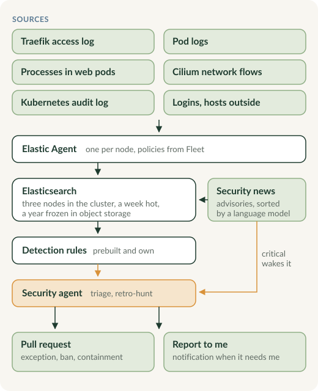

At work I build SOC platforms on the Elastic Stack. At home I run one for my own [Kubernetes cluster](/projects/kubernetes-homelab/), with AI agents doing most of the analyst work.

## What it sees

One Elastic Agent per node collects almost everything, and Elasticsearch runs on the same three nodes as the apps it watches.

- **Web traffic:** the access log of Traefik, every request from the internet with the real client address, parsed by Elastic's own integration.
- **Pod logs** of every container.
- **Processes inside the web pods:** Defend for Containers hooks into the kernel with eBPF and records every program started in the public apps. A web server starting a shell is usually the first visible step after a successful exploit.
- **Network flows** from Cilium: dropped traffic, and new connections from pods to the internet.
- **The Kubernetes audit log:** who changed what in the cluster, and anything changed outside of git.
- **Logins** in the single sign-on, and Elastic Defend on the machines outside the cluster.

Security data stays on the nodes for about a week and is then frozen as snapshots in Hetzner's object storage for a year. A search over months reads from there on demand, which is slow but cheap.

## Rules and agents

Elastic's prebuilt detection rules cover most of it, with my own rules where no package fits. An alert wakes a security agent, part of my [personal AI infrastructure](/projects/personal-ai/). It looks at the alert like an analyst would, closes it or digs deeper, and turns false positives into exceptions through a pull request, so the same noise does not come back. A CI check limits what its pull requests may change. It can also restrict a public app, but only under narrow conditions; usability comes first, and something a rule can catch is detected, not blocked.

## Security news

Some attacks start before a patch exists, and the first warning is in the news, not in my logs. So Elastic reads advisories and security news itself: GitHub security advisories of the projects that run here, CISA's list of exploited vulnerabilities, Hacker News and a few news sites. A language model knows what runs in the cluster and sorts every item: critical wakes the agent right away, medium is looked at once a day, and the rest ends up in a daily digest.

## Everything as code

The whole Elastic configuration, from retention and Fleet policies to detection rules, exceptions and dashboards, is Terraform in git, applied by CI on merge. The stack itself runs through the ECK operator; how to set that up on Talos is in my [ECK on Talos](https://github.com/frederikb96/eck-on-talos) guide.
