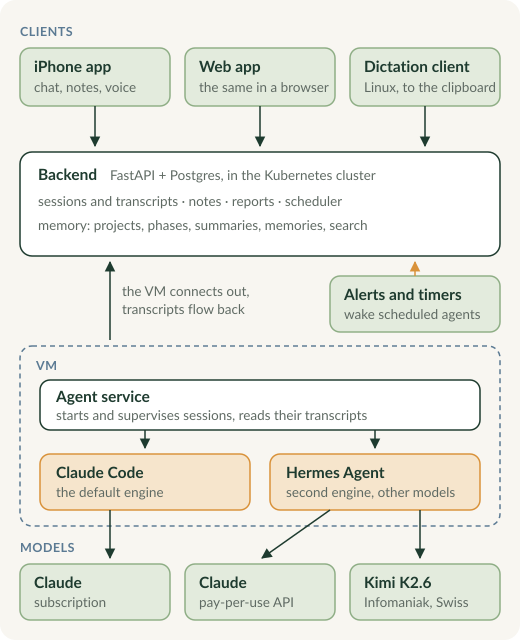

A large part of what I do on a computer starts as a conversation with an AI agent: work on my homelab, research, notes, writing, small scripts. This project is the setup around that. It started as a few hooks and scripts around Claude Code on my laptop and grew into a system of its own.

## Sessions on a VM, driven from anywhere

Every conversation is an ordinary Claude Code session in its own terminal on a virtual machine in my [Kubernetes cluster](/projects/kubernetes-homelab/). A small service on the VM starts and supervises the sessions and keeps one outbound connection to the backend, so the backend never has to reach into the VM. The backend is a FastAPI app with Postgres, with a web app and an [iPhone app](https://github.com/frederikb96/pai-ios) on top. Replies are read from the session's own transcript file, not scraped from a screen. When a session asks something the app cannot show, the terminal itself is streamed to the browser.

On the laptop I mostly talk instead of typing: the [Linux dictation client](https://github.com/frederikb96/pai-stt) streams the microphone to the same backend and puts the text into the clipboard. The phone app has dictation too, and a call mode for talking back and forth.

## Memory

Every conversation is stored and split into projects and phases, with summaries of each turn and phase and short memories extracted from them. Agents search all of it, and a dedicated search agent digs through it when a question needs more than a lookup. My notes live next to it and stay in sync with my Obsidian vault. So a new session does not start from zero: it can find what I decided three months ago and why.

Skills carry the rest. They are plain Markdown files that describe how I want a kind of work done, from how a commit message reads to how a cluster node is updated, and the agents load them for the task at hand.

## Agents on a schedule

A part of the agents runs without me. They are started on a schedule or woken by an alert, and each owns one area: cluster updates and Renovate pull requests, cluster alerts, the Elastic stack, the photo library, and the security analyst of my [homelab SOC](/projects/homelab-soc/). They work through git like I do, open and merge their own pull requests within a scope that CI checks, and end every run with a notification. Only the ones that need me reach my phone; the rest are reports I read when I have time.

## Status

The core, the backend and the VM side, is closed source for now. Too much of it is tied to my own setup to be useful to someone else as it is. The two clients are public, mostly for the parts underneath them: the iOS app is built and signed without a Mac, and the dictation client is a small systemd daemon with a GNOME panel indicator.
